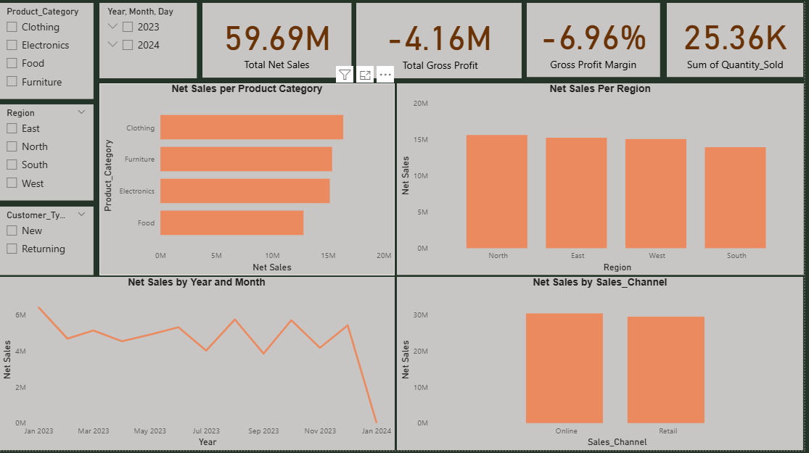
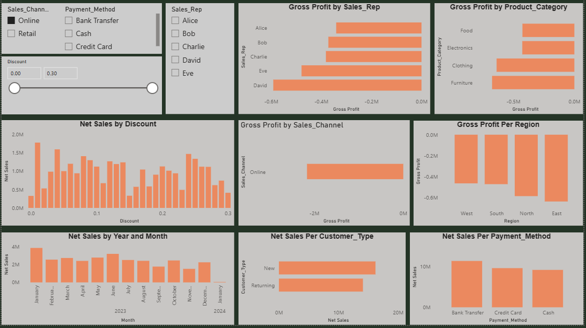

# Serah-s-Portfolio

# End to End Sales Analysis Project

## Project Overview
This project analyzes a synthetic sales dataset containing 1,000 records to understand sales performance and profitability. The goal is to identify patterns in sales, compare business segments, and highlight potential areas for improvement.

## Tools Used
- Microsoft Excel 2016
- Power Query
- MySQL Workbench and SQL
- Power BI

## Data Cleaning and Preparation
Using Excel Power Query, I:
- Checked for duplicate records and missing values.
- Cleaned text fields and reviewed date formats.
- Validated data types.
- Recalculated sales, net sales, cost of goods sold (COGS), and gross profit because the original sales amount required correction.

I then imported the prepared dataset into MySQL and corrected the date column to support date-based analysis.

## Key Analysis and Findings
Using SQL, I analyzed sales and profitability by region, product category, sales representative, customer type, sales channel, and month.

Key findings included:
- Total net sales were approximately $59.69 million.
- Overall gross profit was approximately -$4.16 million.
- 60.4% of records generated a gross loss under the calculation assumptions used.
- North recorded the highest net sales among the regions.
- Clothing recorded the highest net sales among product categories but also the largest gross loss.
- Higher discount levels generally coincided with lower gross profit margins.

## Dashboard
The Power BI dashboard presents sales and profitability metrics through visualizations and interactive filters, allowing users to explore performance across different business segments.

## Recommendations
- Review discounts that result in selling prices below unit cost.
- Monitor sales revenue alongside gross profit and profit margins.
- Investigate differences in profitability across regions and product categories.
- Validate pricing and cost assumptions before making business decisions.

## Limitations
The dataset is synthetic, and monetary amounts are assumed to be in USD because the original currency has not been verified. Gross profit excludes operating expenses and other costs not included in the dataset. The findings demonstrate the analytical process and should not be treated as verified results from a real business.

## Conclusion
This project demonstrates my ability to clean and prepare data, use SQL to analyze business performance, identify potential profitability issues, and communicate findings through data visualization.
